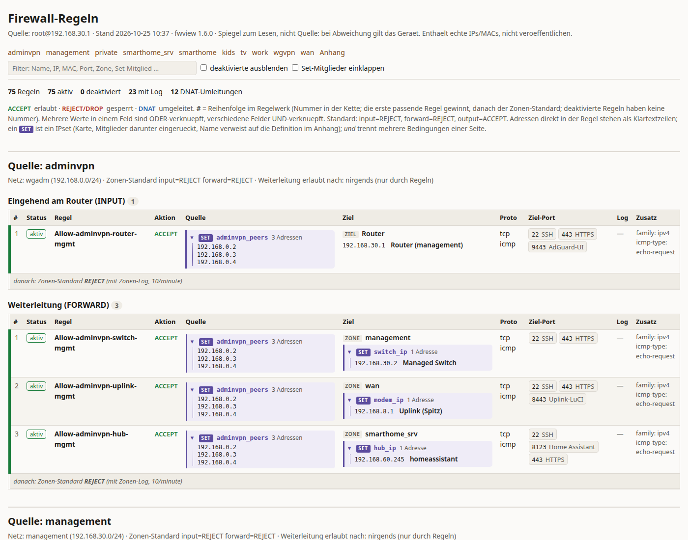
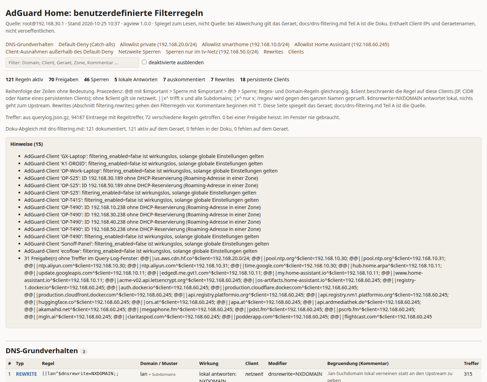
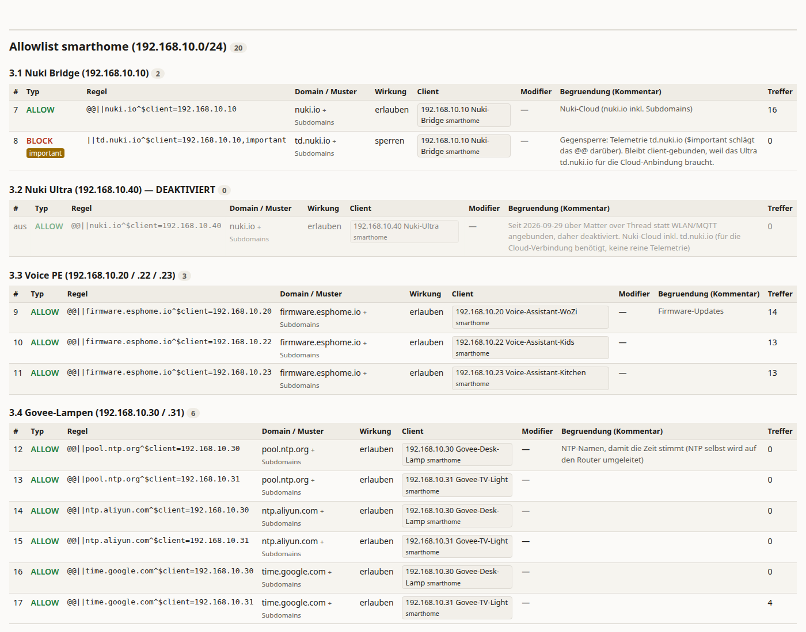

# openwrt-audit-kit

Lesende Werkzeuge für ein OpenWrt-Heimnetz mit AdGuard Home: Firewall und DNS-Regeln als
lesbare Spiegelseiten rendern, Firewall- und Query-Log für Audits auswerten. Alles läuft auf
der Workstation gegen den Router per
SSH (Key-Auth, `BatchMode`), nichts wird auf dem Gerät geschrieben, mit einer gekennzeichneten
Ausnahme (`pushset.sh`). Nur Python-3-Standardbibliothek und POSIX-Shell.

Entstanden aus der Dokumentation eines konkreten Netzes (OpenWrt One, AdGuard Home, GL.iNet
Spitz Plus als LTE-Uplink). Defaults wie
`root@192.168.30.1` stammen daher und sind per Option oder Variable änderbar.

**Projektseite:** <https://one7two99.github.io/openwrt-audit-kit/> (Quelle: `docs/index.html`) erklärt
Hintergrund, Werkzeuge und Audit-Ablauf mit Screenshots.

**Angepasstes firewall4:** Der Router hinter diesem Kit läuft mit einem Patch, der `option ipset` zu
`list ipset` macht. Mehrere IP-Sets in einer Regel sind UND-verknüpft, Richtung je Eintrag; damit kann ein
Set als Quelle **und** ein anderes als Ziel derselben Regel dienen, und Regeln arbeiten mit Objekten statt
Einzeleinträgen. Upstream eingereicht als
[openwrt/firewall4#109](https://github.com/openwrt/firewall4/pull/109) (Feature plus drei Fixes) und
[openwrt/firewall4#110](https://github.com/openwrt/firewall4/pull/110) (unbekannte Tokens in Set-Referenzen
ablehnen). Das Kit funktioniert auch ohne den Patch; `fwview.py` rendert dann Regeln mit einem Set.

## Werkzeuge

| Skript | Zweck | Schreibt auf das Gerät? |
|---|---|---|
| `scripts/fwview.py` | Live-Firewall (`uci export firewall/dhcp/network`) als eine HTML-Seite je Quellzone plus JSON-Report. Löst IPs/MACs zu Gerätenamen und Zonen auf. Enthält den Resolver, den die drei folgenden Skripte importieren. | nein |
| `scripts/agview.py` | AdGuard-Benutzerregeln, Rewrites und persistente Clients als HTML plus JSON. Liest aus `adguardhome.yaml` nur die Abschnitte `user_rules`, `filtering`, `clients`. Optional Abgleich gegen eine Markdown-Doku (`--doc`, sonst `--no-doc`) und Trefferzahl je Regel aus dem Query-Log (`--querylog`). | nein |
| `scripts/fwlog-audit.py` | Audit-Tabellen (Markdown) aus dem Firewall-Log eines Zeitfensters: Zeilen je Log-Klasse, Stundenprofil, INPUT-Rauschen je Zone, Verkehr zwischen Zonen, Egress-Blocks je Regel, Log-Limit-Sättigung, Scan-Indikatoren. | nein |
| `scripts/dnslog-audit.py` | Audit-Tabellen aus dem AdGuard-Query-Log: Volumen je Client und Zone, Blocklisten, Reichweite der Default-Deny-Zonen, DoH/DoT-Umgehung, Anfragetypen, NXDOMAIN, Tunnel-Heuristik, Rate-Limit-Sättigung, Upstream-Latenz. | nein |
| `scripts/pushset.sh` | Prüft eine IP-Set-Datei lokal, kopiert sie auf den Router und lädt das fw4-Set (`option loadfile`) neu. Fragt vor jedem Schreibschritt. | **ja** |
| `scripts/wificli.sh` | Einzelne SSIDs oder ganze Radios per UCI an- und ausschalten. Läuft auf dem Router. Warnung im Kopf lesen: das 5-GHz-Radio kann das eigene Admin-WLAN tragen. | ja (UCI) |
| `scripts/modemctl.sh` | LTE-Modem eines GL.iNet Spitz Plus (GL-X2000) ein- und ausschalten, mit Anleitung zur USB-Bus-ID. Läuft auf dem Spitz. | ja |

Jedes Skript trägt im Kopfkommentar Zweck, Aufruf, Optionen und Exit-Codes. Die Python-Skripte
haben einen `--from-dir`-Modus, der gespeicherte `uci export`-Ausgaben statt SSH liest.
`scripts/sets/` enthält drei IP-Set-Dateien (öffentliche DoH/DoT-Resolver, Google- und
Cloudflare-Netze) als Eingabe für `pushset.sh`.

Verweise auf `docs/firewall-rules.md`, `docs/dns-filtering.md` oder `docs/network-documentation.md`
in den Kopfkommentaren meinen die Netzdokumentation des Ursprungsprojekts; sie ist nicht Teil dieses
Repos. `agview.py` überspringt den Doku-Abgleich stillschweigend, wenn die Datei fehlt.

## Typischer Audit-Lauf

```sh
# Query-Log komprimiert holen (AdGuard schreibt es erst ab 1.000 gepufferten Einträgen)
ssh root@192.168.30.1 'gzip -c /var/persist/adguardhome/data/querylog.json' > /tmp/querylog.json.gz

scripts/fwlog-audit.py --since '2026-10-25 00:30' --out fwlog.md
scripts/dnslog-audit.py --since '2026-10-25 00:30' --querylog /tmp/querylog.json.gz --out dnslog.md

# Spiegelseiten des Regelwerks
scripts/fwview.py --out fwview.html
scripts/agview.py --out agview.html --querylog /tmp/querylog.json.gz --no-doc
```

Die Tabellen sind die Daten eines Audits. Befunde, Bewertung und Vorschläge schreibt man von Hand
darüber; das Repo enthält bewusst keine fertigen Audit-Berichte, nur Skript-Ausgaben.

## Beispielausgaben (`reports/`)

Echte Läufe von `fwview.py` und `agview.py` aus dem Ursprungsnetz, pseudonymisiert: **alle
MAC-Adressen** durch deterministische Pseudonyme ersetzt (`02:…`, lokal verwaltet, konsistent über
beide Dateien), Personenbezug entfernt (Gerätepräfixe `OP-…`, Personen-Initialen in Gerätenamen
durch `K1-`/`K2-`/`GX-`). Private IP-Adressen und Zonen sind unverändert, damit die Tabellen lesbar
bleiben.

| Datei | Inhalt |
|---|---|
| [`example-fwview.html`](https://one7two99.github.io/openwrt-audit-kit/example-fwview.html) | Spiegelseite der Firewall aus `fwview.py` |
| [`example-agview.html`](https://one7two99.github.io/openwrt-audit-kit/example-agview.html) | Spiegelseite der AdGuard-Regeln aus `agview.py`, mit Trefferzahlen und Doku-Abgleich |

Die Links zeigen auf die gerenderten Kopien unter `docs/` (GitHub Pages); die Dateien in `reports/` sind identisch.

Beide Dateien sind eigenständig (Stylesheet inline, keine externen Verweise).

**`fwview.py`**: eine Sektion je Quellzone, INPUT getrennt von FORWARD, IP-Sets aufgeklappt mit
Mitgliedern und Gerätenamen.



**`agview.py`**: Regeln nach den Überschriften der AdGuard-Liste gruppiert, Treffer je Regel aus
dem Query-Log, Hinweise zu Clients und ungenutzten Freigaben, Abgleich gegen die Doku.





## Voraussetzungen

- Workstation: Python ≥ 3.9 (`zoneinfo`), OpenSSH, für `pushset.sh` zusätzlich `scp`.
- Router: OpenWrt mit fw4/nftables, dropbear mit Key-Auth für `root`, AdGuard Home mit
  Query-Log als Datei. Das persistente System-Log wird unter `/mnt/nvme/log/system.log`
  erwartet (`LOG_PATH` in `fwlog-audit.py`).
- Gerätenamen kommen aus den DHCP-Reservierungen des Routers (`uci export dhcp`).

## Sicherheit und Daten

Die Ausgaben enthalten echte IP-Adressen, MACs und Gerätenamen des untersuchten Netzes.
Erzeugte `fwview-*`, `agview-*`, `fwlog-audit-*` und `dnslog-audit-*` Dateien sind per
`.gitignore` ausgeschlossen. Kein Skript liest WLAN-Passphrasen, WireGuard-Schlüssel oder
die vollständige `adguardhome.yaml`.

## Lizenz

MIT, siehe `LICENSE`.
